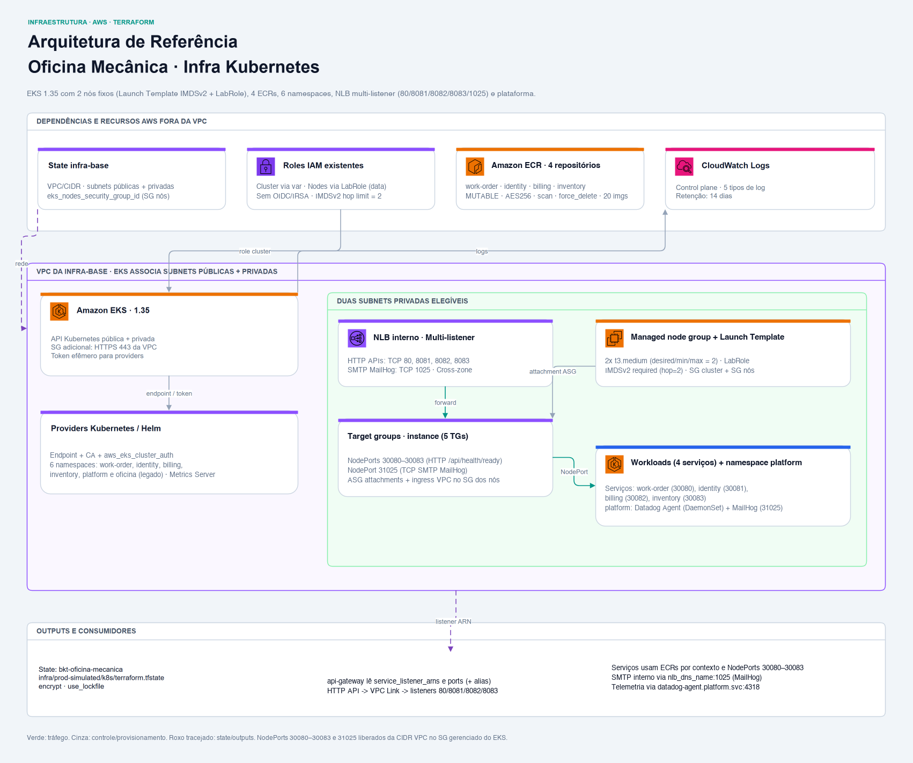

<div align="center">

# ☸️ Oficina Mecânica — Plataforma Kubernetes e Contêineres (IaC)

**Provisionamento e configuração do cluster EKS multi-serviço, Node Group, repositórios ECR, NLB interno e componentes de plataforma Kubernetes (Datadog Agent, MailHog e Metrics Server) para a solução Oficina Mecânica.**


</div>

## 📋 Sobre

Este repositório contém o código de **Infraestrutura como Código (IaC)** e os manifests de plataforma responsáveis pelo provisionamento do cluster **Amazon EKS**, **Managed Node Group com Launch Template**, **Amazon ECR por microsserviço**, **namespaces isolados**, **Network Load Balancer interno multi-listener** e dos componentes compartilhados do namespace `platform` (**Datadog Agent** e **MailHog**) para a solução **Oficina Mecânica**.

Faz parte do ecossistema de serviços e infraestrutura da pós-graduação em Arquitetura de Software da FIAP (turma 15SOAT).

A [API de Ordens de Serviço](https://github.com/FIAP-15SOAT/oficina-mecanica-work-order-service) e a arquitetura da Fase 4 no repositório de especificações documentam a topologia completa da solução.

---

### 🏗️ Recursos Provisionados

Um mapa central `local.services` em `terraform/locals.tf` declara os quatro bounded contexts (`work-order`, `identity`, `billing` e `inventory`) com seus respectivos NodePorts e portas de listener, gerando recursos por serviço via `for_each`:

| Contexto | Namespace | Repositório ECR | Target Group | NodePort | Listener NLB |
| --- | --- | --- | --- | --- | --- |
| `work-order` | `work-order` (e legado `oficina`) | `ecr-oficina-mecanica-work-order` | `tg-oficina-mecanica-work-order` | `30080` | `80/TCP` |
| `identity` | `identity` | `ecr-oficina-mecanica-identity` | `tg-oficina-mecanica-identity` | `30081` | `8081/TCP` |
| `billing` | `billing` | `ecr-oficina-mecanica-billing` | `tg-oficina-mecanica-billing` | `30082` | `8082/TCP` |
| `inventory` | `inventory` | `ecr-oficina-mecanica-inventory` | `tg-oficina-mecanica-inventory` | `30083` | `8083/TCP` |
| *(Plataforma SMTP)* | `platform` | *(imagem pública `mailhog/mailhog:v1.0.1`)* | `tg-oficina-mecanica-smtp` | `31025` | `1025/TCP` |

1. **Amazon EKS, Launch Template & Nós Gerenciados (`eks.tf`)**:
   - Cluster Kubernetes gerenciado na versão declarada **1.35**, com endpoints público e privado ativados e associação às subnets públicas e privadas da infra-base.
   - Logs de `api`, `audit`, `authenticator`, `controllerManager` e `scheduler` centralizados no **CloudWatch Logs** (`/aws/eks/eks-oficina-mecanica/cluster`), com retenção de 14 dias.
   - Security Group adicional para o control plane (`secgrp-eks-cluster-oficina-mecanica`), liberando HTTPS (porta 443) a partir do CIDR da VPC.
   - **Launch Template (`aws_launch_template.eks_nodes`)** com `instance_type = var.node_instance_type` (`t3.medium`), **IMDSv2 obrigatório** (`http_tokens = "required"`) com **`http_put_response_hop_limit = 2`** (permitindo que os pods alcancem o IMDS do nó para obter credenciais AWS temporárias) e anexação explícita de dois Security Groups: o Security Group gerenciado do cluster e o Security Group de identidade dos nós (`secgrp-eks-nodes-oficina-mecanica`, lido do state da infra-base).
   - **Managed Node Group** nas subnets privadas com **2 nós `t3.medium` fixos** (`desired = min = max = 2`, até 34 pods no total pelo VPC CNI) e `node_role_arn` apontando diretamente para a **`LabRole`** (`data.aws_iam_role.lab_role`), sem variável por conta para os nós (ver [ADR 0008](docs/adr/0008-escalonamento-do-node-group-para-2-nos-t3-medium.md) e [ADR 0010](docs/adr/0010-launch-template-com-imdsv2-e-labrole-nos-nos.md)).

2. **Amazon ECR por Serviço (`ecr.tf`)**:
   - Quatro repositórios `ecr-oficina-mecanica-<contexto>` gerados via `for_each = local.services`, com scan de vulnerabilidades no push (`scan_on_push = true`), criptografia AES-256, `image_tag_mutability = "MUTABLE"` e `force_delete = true` (para permitir teardown limpo ao final da sessão do laboratório).
   - Política de ciclo de vida individual por repositório mantendo as últimas 20 imagens de cada microsserviço (ver [ADR 0004](docs/adr/0004-ecr-scan-on-push-tags-mutaveis.md)).

3. **Namespaces por Serviço e Plataforma (`k8s_namespace.tf`)**:
   - Criação via `for_each` dos namespaces `work-order`, `identity`, `billing`, `inventory` e `platform` (além do namespace legado `oficina` durante a transição até a C-12), todos rotulados com `app.kubernetes.io/part-of = oficina-mecanica` e `managed-by = terraform` (ver [ADR 0007](docs/adr/0007-isolamento-por-namespace-e-ecr-por-bounded-context.md)).

4. **Metrics Server via Helm (`k8s_metrics_server.tf`)**:
   - Implantação do Helm chart oficial de `metrics-server` em `kube-system`, fornecendo métricas de CPU e memória aos HPAs dos microsserviços.

5. **NLB Interno Multi-Listener e SMTP (`nlb.tf`)**:
   - **Network Load Balancer interno** (`nlb-oficina-mecanica`) nas subnets privadas, com `enable_cross_zone_load_balancing = true`.
   - **Listeners e Target Groups por microsserviço (`for_each = local.services`)**: listeners TCP nas portas `80`, `8081`, `8082` e `8083` encaminhando aos target groups `tg-oficina-mecanica-<contexto>` (`instance` mode) nos NodePorts `30080` a `30083`, com health check HTTP em `/api/health/ready`, attachment automático no ASG do Node Group e regras de entrada no Security Group do cluster restritas ao CIDR da VPC.
   - **Listener e Target Group SMTP (`1025/TCP` → NodePort `31025`)**: expõe o SMTP do MailHog no NLB interno (`tg-oficina-mecanica-smtp`, health check TCP) para que funções AWS Lambda e workloads na VPC enviem e-mails (ver [ADR 0009](docs/adr/0009-nlb-interno-unico-com-listeners-por-porta.md)).

6. **Componentes do Namespace `platform` (`k8s/platform/`)**:
   - **Datadog Agent (`datadog-agent.yaml`, `datadog-service.yaml`)**: `ServiceAccount`, `ClusterRole`, `ClusterRoleBinding`, `DaemonSet` (`gcr.io/datadoghq/agent:7.83.1`) e `Service` ClusterIP `datadog-agent` na porta `4318` (OTLP HTTP), coletando traces, métricas e logs de todos os namespaces. O Secret `datadog-secret` é criado pelo job `platform-apply` do CD via stdin a partir do secret `DD_API_KEY`, sem passar pelo state do Terraform nem por arquivos em disco.
   - **MailHog (`mailhog-deployment.yaml`, `mailhog-service.yaml`)**: `Deployment` (`mailhog/mailhog:v1.0.1`), `Service` ClusterIP `mailhog` (`1025` e `8025`) e `Service` NodePort `mailhog-smtp` (`1025` → NodePort `31025`).



---

## 🔗 Integração com `oficina-mecanica-infra-base`

Este repositório consome a fundação de rede (VPC, Subnets públicas e privadas, CIDR e o Security Group de identidade dos nós `eks_nodes_security_group_id`) provisionada pelo repositório [`oficina-mecanica-infra-base`](https://github.com/FIAP-15SOAT/oficina-mecanica-infra-base) diretamente via **Remote State** no Amazon S3:

```hcl
data "terraform_remote_state" "aws_base" {
  backend = "s3"
  config = {
    bucket = var.aws_base_state_bucket
    key    = var.aws_base_state_key
    region = var.aws_base_state_region
  }
}
```

---

## 🔗 Integração com `oficina-mecanica-api-gateway` e Lambdas

Este repositório é dono do **caminho privado de entrada** dos microsserviços e do SMTP, publicando os mapas `service_listener_arns` e `service_listener_ports` com o ARN e a porta TCP do listener de cada bounded context no NLB interno (`work-order` na porta `80`, `identity` na `8081`, `billing` na `8082` e `inventory` na `8083`). O [`oficina-mecanica-api-gateway`](https://github.com/FIAP-15SOAT/oficina-mecanica-api-gateway) lê esses mapas para ligar cada grupo de rotas ao listener do serviço dono:

```text
cliente → API Gateway (HTTP API) → VPC Link V2 → NLB interno (listeners 80/8081/8082/8083) → NodePorts (30080..30083) → Pods dos serviços
Lambda / VPC → NLB interno (listener 1025, nlb_dns_name:smtp_listener_port) → NodePort (31025) → Pod do MailHog (namespace platform)
```

O balanceador fica **neste** repositório, e não no do Gateway, porque depende de dois recursos deste stack: o **Auto Scaling Group** do managed node group (alvo dos `aws_autoscaling_attachment`) e o **security group gerenciado do cluster** (onde as regras de ingress dos NodePorts são criadas). Assim, uma substituição do node group refaz o vínculo no mesmo `apply`, em vez de deixar o Gateway apontando para um ASG inexistente. O raciocínio completo, com as alternativas descartadas, está no [ADR 0009](docs/adr/0009-nlb-interno-unico-com-listeners-por-porta.md) e nos ADRs [0003](https://github.com/FIAP-15SOAT/oficina-mecanica-api-gateway/blob/main/docs/adr/0003-integracao-privada-com-o-eks.md) e [0005](https://github.com/FIAP-15SOAT/oficina-mecanica-api-gateway/blob/main/docs/adr/0005-integracao-privada-por-servico-e-tabela-de-donos.md) do Gateway.

> ⚠️ **O NLB é criado sem security group.** Um NLB criado sem SG **não pode receber um depois** — só substituindo o balanceador. A decisão é deliberada: as regras permitem os NodePorts (`30080`–`30083` e `31025`) para toda a CIDR da VPC, incluindo nodes, ENIs da Lambda/VPC Link e outros recursos internos. O raciocínio completo está no [ADR 0003 do Gateway](https://github.com/FIAP-15SOAT/oficina-mecanica-api-gateway/blob/main/docs/adr/0003-integracao-privada-com-o-eks.md).

---

## 📁 Estrutura do Repositório

```text
.
├── .github/
│   └── workflows/
│       ├── cd.yml  # Terraform apply + job platform-apply (Datadog Secret via stdin e k8s/platform/)
│       └── ci.yml  # Valida Terraform e abre PR; plan condicionado a credenciais
├── docs/
│   ├── adr/
│   │   ├── 0001-suporte-a-hpa-e-dimensionamento-do-node-group.md
│   │   ├── 0002-eks-como-distribuicao-gerenciada.md
│   │   ├── 0003-endpoint-publico-e-privado-simultaneos.md
│   │   ├── 0004-ecr-scan-on-push-tags-mutaveis.md
│   │   ├── 0005-auth-providers-k8s-helm-via-token-iam-efemero.md
│   │   ├── 0006-namespace-unico-compartilhado.md
│   │   ├── 0007-isolamento-por-namespace-e-ecr-por-bounded-context.md
│   │   ├── 0008-escalonamento-do-node-group-para-2-nos-t3-medium.md
│   │   ├── 0009-nlb-interno-unico-com-listeners-por-porta.md
│   │   └── 0010-launch-template-com-imdsv2-e-labrole-nos-nos.md
│   ├── diagrams/
│   │   ├── cd-workflow.png  # Jobs e steps do workflow de CD
│   │   ├── ci-workflow.png  # Jobs e steps do workflow de CI
│   │   └── infrastructure.png  # Arquitetura do componente
│   └── ci-cd.md  # Jobs, steps, conditions e diagramas de CI/CD
├── k8s/
│   └── platform/
│       ├── datadog-agent.yaml  # ServiceAccount, ClusterRole, ClusterRoleBinding e DaemonSet no namespace platform
│       ├── datadog-service.yaml  # Service ClusterIP (porta 4318 OTLP HTTP) no namespace platform
│       ├── mailhog-deployment.yaml  # Deployment mailhog/mailhog:v1.0.1 no namespace platform
│       └── mailhog-service.yaml  # Services ClusterIP (1025/8025) e NodePort mailhog-smtp (31025)
├── terraform/
│   ├── .terraform.lock.hcl  # Versões e checksums dos providers
│   ├── backend.tf  # Backend S3 e lock nativo
│   ├── ecr.tf  # Repositórios ECR por serviço e lifecycle policies
│   ├── eks.tf  # EKS, Launch Template IMDSv2, node group 2 nós com LabRole, SG e logs
│   ├── k8s_metrics_server.tf  # Release Helm em kube-system
│   ├── k8s_namespace.tf  # Namespaces por serviço e platform via for_each
│   ├── locals.tf  # Mapa services, portas SMTP e convenções de nomes
│   ├── nlb.tf  # NLB interno, target groups, listeners, attachments e ingress rules por serviço + SMTP
│   ├── outputs.tf  # Outputs em mapa por contexto e DNS/SMTP do NLB
│   ├── providers.tf  # Providers e leitura de remote state da infra-base
│   ├── terraform.tfvars  # Configuração estável da stack
│   ├── terraform.tfvars.example  # Referência para configurar o ambiente
│   └── variables.tf  # Variáveis de entrada
├── .gitignore  # Arquivos locais ignorados
└── README.md  # Entrada do componente e guia local
```

---

## 💾 Estado Remoto (Remote State)

O estado desta stack é armazenado no S3, com criptografia e lock nativo:

- **Bucket**: o valor da variável de Actions da organização `TF_STATE_BUCKET`, passado no `terraform init` por `-backend-config`
- **Chave (Key)**: `infra/prod-simulated/infra-k8s/terraform.tfstate`
- **Região**: `us-east-1`
- **Lock**: `use_lockfile = true`

---

## ⚙️ Variáveis e Saídas

### Principais Variáveis de Entrada

| Variável | Tipo | Default | Descrição | Uso |
| --- | --- | --- | --- | --- |
| `aws_region` | `string` | `us-east-1` | Região da AWS | Região dos recursos |
| `project_name` | `string` | `oficina-mecanica` | Nome do projeto | Compõe nomes dos recursos |
| `environment` | `string` | `prod-simulated` | Nome do ambiente | Tag Environment |
| `kubernetes_version` | `string` | `1.35` | Versão do Kubernetes no EKS | Versão declarada do EKS |
| `eks_cluster_role_name` | `string` | `""` | Nome da role IAM existente para o control plane do cluster | `TF_VAR_eks_cluster_role_name` / Variable `EKS_CLUSTER_ROLE_NAME` (os nós usam `LabRole` diretamente) |
| `node_instance_type` | `string` | `t3.medium` | Tipo de instância EC2 configurado no Launch Template dos nós | Até 17 pods por nó (34 pods nos 2 nós) |
| `node_desired_size` | `number` | `2` | Quantidade desejada de nós | Escala fixa em 2 nós |
| `node_min_size` | `number` | `2` | Quantidade mínima de nós | Escala fixa em 2 nós |
| `node_max_size` | `number` | `2` | Quantidade máxima de nós | Escala fixa em 2 nós |
| `aws_base_state_bucket` | `string` | — | Bucket S3 do state de rede (`infra-base`) | `TF_VAR_aws_base_state_bucket`, preenchida pelos workflows com `TF_STATE_BUCKET` |
| `aws_base_state_key` | `string` | `infra/prod-simulated/infra-base/terraform.tfstate` | Chave do state de rede (`infra-base`) | Key estável do state de rede |
| `aws_base_state_region` | `string` | `us-east-1` | Região do state de rede | Região do state de rede |
| `enable_metrics_server` | `bool` | `true` | Se deve instalar o Metrics Server via Helm | Habilita o release Helm |
| `metrics_server_chart_version` | `string` | `""` | Versão opcional do chart do Metrics Server (`3.13.0` em `terraform.tfvars`) | Fixa versão do chart Helm |

O `terraform.tfvars` versionado guarda a configuração estável da stack. Os valores que dependem da conta AWS vêm de variáveis de ambiente/Actions: o bucket vem da Variable da organização `TF_STATE_BUCKET` e a role do control plane vem da Variable `EKS_CLUSTER_ROLE_NAME`. Os nós do EKS usam a role `LabRole` diretamente via `data "aws_iam_role" "lab_role"`.

---

### Saídas Exportadas (Outputs)

| Output | Descrição | Uso |
| --- | --- | --- |
| `cluster_name` | Nome do cluster EKS provisionado | Nome para `kubeconfig` e CDs dos serviços |
| `cluster_endpoint` | Endpoint do control plane do EKS | Endpoint da API Kubernetes |
| `cluster_certificate_authority_data` | Certificado CA do EKS codificado em base64 | CA do EKS codificada em base64 |
| `cluster_version` | Versão ativa do Kubernetes | Versão do cluster |
| `service_listener_arns` | Mapa `contexto → ARN` dos listeners TCP do NLB interno (`work-order`, `identity`, `billing`, `inventory`) | Consumido pelo `oficina-mecanica-api-gateway` para rotear para cada microsserviço |
| `service_listener_ports` | Mapa `contexto → porta TCP` dos listeners do NLB interno (`80`, `8081`, `8082`, `8083`) | Consumido pelo `oficina-mecanica-api-gateway` para liberar a saída do VPC Link só nas portas dos listeners |
| `nlb_dns_name` | Nome DNS interno do NLB (`nlb-oficina-mecanica`) | Alcançado por Lambdas e recursos internos da VPC |
| `smtp_listener_port` | Porta TCP do listener SMTP no NLB interno (`1025`) | Usada junto de `nlb_dns_name` para envio de e-mail ao MailHog |
| `zz_next_steps` | Guia rápido pós-deploy para configurar `kubeconfig` e validar acesso | Exibido ao final do `terraform output` |

---

## 🚀 Como Executar Localmente

### Pré-requisitos

1. Infraestrutura de rede previamente provisionada via [infra-base](https://github.com/FIAP-15SOAT/oficina-mecanica-infra-base), com state acessível.
2. **Terraform ≥ 1.11.0**, com providers AWS ≥ 6.46.0/<7, Kubernetes ≥ 2.32.0/<3 e Helm ≥ 3/<4. As versões instaladas ficam em `terraform/.terraform.lock.hcl`.
3. **AWS CLI v2** configurada com as três credenciais temporárias do AWS Academy; permissões AWS e acesso Kubernetes adequados à conta atual.
4. Nome do bucket de state e da role IAM existente do cluster (`EKS_CLUSTER_ROLE_NAME`), exportados no shell (passo 3). Os nós usam a `LabRole` diretamente via `data.aws_iam_role`. Variables do GitHub não são lidas automaticamente no terminal local.
5. `terraform.tfvars` versionado com a configuração estável da stack; os valores que dependem da conta vêm das variáveis.
6. **kubectl** para aplicar e diagnosticar os manifests do namespace `platform` após o apply. O Helm CLI não é pré-requisito deste Terraform, que usa o provider Helm.

### Passo a Passo

```bash
# 1. Clonar o repositório
git clone https://github.com/FIAP-15SOAT/oficina-mecanica-infra-k8s.git

# 2. Entrar no diretório da configuração Terraform
cd oficina-mecanica-infra-k8s/terraform

# 3. Informar o bucket de state e a role do cluster e inicializar os providers e o backend S3
export TF_STATE_BUCKET=<nome do bucket>
export TF_VAR_aws_base_state_bucket="$TF_STATE_BUCKET"
export TF_VAR_eks_cluster_role_name=<role do cluster>
terraform init -backend-config="bucket=$TF_STATE_BUCKET"

# 4. Verificar a formatação sem modificar arquivos
terraform fmt -check -recursive

# 5. Validar a configuração antes de consultar o plano
terraform validate

# 6. Visualizar o plano com a rede e a role da conta atual
terraform plan

# 7. Aplicar a plataforma após revisar o plano
terraform apply

# 8. Consultar o nome do cluster e os demais outputs
terraform output

# 9. Atualizar o kubeconfig local, validar com dry-run no servidor e aplicar os manifests de plataforma
aws eks update-kubeconfig --region us-east-1 --name eks-oficina-mecanica
kubectl apply --dry-run=server -f ../k8s/platform/
kubectl create secret generic datadog-secret \
  --namespace platform \
  --from-literal=DD_API_KEY="$DD_API_KEY" \
  --dry-run=client -o yaml | kubectl apply -f -
kubectl apply -f ../k8s/platform/

# 10. Conferir os nodes e os pods do namespace platform
kubectl get nodes
kubectl get pods -n platform
```

Se mudar `project_name` ou a região, use o `cluster_name` exportado e a região
correspondente no comando de kubeconfig. Os providers Kubernetes/Helm do
Terraform usam endpoint, CA e token temporário de `aws_eks_cluster_auth`; não
dependem desse kubeconfig local. O token pode expirar durante uma operação longa.

### Validação estática, sem sessão AWS ativa

Na pasta `terraform/`:

```bash
# Verificar a formatação dos arquivos Terraform
terraform fmt -check -recursive

# Instalar os providers sem conectar ao backend remoto
terraform init -backend=false

# Validar a sintaxe e os schemas da configuração
terraform validate
```

`init` requer acesso ao registry ou cache. Acrescente `-lockfile=readonly` se já
houver lockfile e quiser preservar suas versões/checksums. Depois dessa
inicialização estática, use `terraform init -reconfigure -backend-config="bucket=$TF_STATE_BUCKET"` antes do plan remoto.
A validação estática não consulta os states nem comprova permissões, capacidade do
cluster ou resultado de um plan (e `kubectl apply --dry-run` exige um cluster acessível para descoberta de schemas).

### Encerramento do laboratório

- Remova primeiro Gateway/Lambda e os workloads dependentes dos serviços.
- Mantenha o EKS acessível para remover os namespaces e o release Helm antes de destruir a plataforma; os providers dependem da autenticação no cluster.
- Os repositórios ECR (`ecr-oficina-mecanica-<contexto>`) possuem `force_delete = true`, portanto são removidos automaticamente pelo `terraform destroy` mesmo quando contêm imagens publicadas (não é necessário esvaziá-los manualmente).
- Destrua Kubernetes antes da infra-base, com a sessão AWS válida:

```bash
# Revisar a remoção da plataforma
terraform plan -destroy

# Remover os recursos após encerrar seus consumidores
terraform destroy
```

EKS, EC2, NLB, ECR e logs podem consumir crédito enquanto existem. Encerrar a
sessão não comprova sua remoção. Não há workflow de destroy nesta stack. A coleta
do Datadog Agent e o MailHog no namespace `platform` pertencem a esta stack (aplicados pelo job `platform-apply` do CD), enquanto dashboards, monitores e testes sintéticos são responsabilidade do repositório de
[monitoramento](https://github.com/FIAP-15SOAT/oficina-mecanica-custom-monitoring);
os logs do control plane no CloudWatch também pertencem a esta stack.

---

## 🔄 Pipelines de CI/CD

O repositório conta com dois workflows automatizados via GitHub Actions:

- **CI**: push em `feature/**` e `fix/**`; valida Terraform, faz plan quando a autenticação AWS está disponível e abre PR para `main` com GitHub App.
- **CD**: push em `main` ou `workflow_dispatch`; executa o job `terraform-k8s-base` (plan/apply do Terraform) seguido do job `platform-apply` (validação de `DD_API_KEY`, criação de `datadog-secret` por stdin no namespace `platform`, `kubectl apply -f k8s/platform/` e verificação de rollout do Datadog Agent e do MailHog).

A [documentação de CI/CD](docs/ci-cd.md) explica cada job/step, conditions, autenticação, configuração GitHub e falhas, e **renderiza os diagramas de CI e CD**.

---

## 📐 Decisões Arquiteturais

- [ADR 0001 — Suporte ao HPA da API e dimensionamento do Node Group (substituído pela ADR 0008)](docs/adr/0001-suporte-a-hpa-e-dimensionamento-do-node-group.md)
- [ADR 0002 — Amazon EKS como distribuição gerenciada de Kubernetes](docs/adr/0002-eks-como-distribuicao-gerenciada.md)
- [ADR 0003 — Endpoint do control plane EKS público e privado simultaneamente](docs/adr/0003-endpoint-publico-e-privado-simultaneos.md)
- [ADR 0004 — Amazon ECR por serviço com scan-on-push, tags mutáveis, force_delete e retenção de 20 imagens](docs/adr/0004-ecr-scan-on-push-tags-mutaveis.md)
- [ADR 0005 — Providers Kubernetes/Helm autenticados por token IAM efêmero](docs/adr/0005-auth-providers-k8s-helm-via-token-iam-efemero.md)
- [ADR 0006 — Namespace único compartilhado (substituído pela ADR 0007)](docs/adr/0006-namespace-unico-compartilhado.md)
- [ADR 0007 — Namespace por serviço e namespace de plataforma](docs/adr/0007-isolamento-por-namespace-e-ecr-por-bounded-context.md)
- [ADR 0008 — Dois nós `t3.medium` fixos no Node Group](docs/adr/0008-escalonamento-do-node-group-para-2-nos-t3-medium.md)
- [ADR 0009 — NLB interno com listener por serviço e listener SMTP](docs/adr/0009-nlb-interno-unico-com-listeners-por-porta.md)
- [ADR 0010 — Credenciais AWS dos pods pela `LabRole` como role do nó com Launch Template IMDSv2](docs/adr/0010-launch-template-com-imdsv2-e-labrole-nos-nos.md)

## 👥 Autores

- [Guilherme da Rocha Salvador](https://github.com/guilhermesalvador404)
- [Lucas Almeida da Silva](https://github.com/lucas-almeida-silva)
- [Ramoon Lincoln Barros Camacho](https://github.com/ramooncamacho)
- [Renan Santana Camacho](https://github.com/renancamacho)

## 📄 Licença

Projeto acadêmico (FIAP — 15SOAT), para fins educacionais. Sem licença aberta declarada (`UNLICENSED`).
