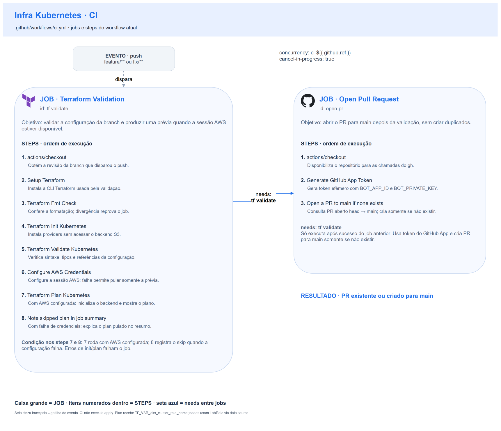
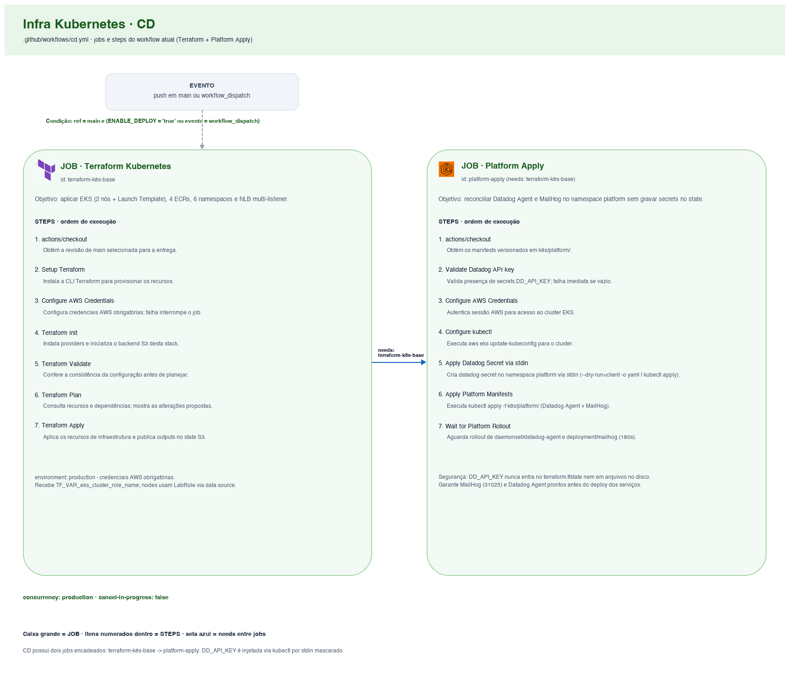

# 🔄 CI/CD — Plataforma Kubernetes

Dois workflows do GitHub Actions, um por responsabilidade: validar a branch e
abrir PR (**CI**), ou aplicar a infraestrutura e os manifests de plataforma (**CD**). A fonte executável é
[ci.yml](../.github/workflows/ci.yml) e [cd.yml](../.github/workflows/cd.yml).

## Índice

- [Fluxo de branch e Pull Request](#fluxo-de-branch-e-pull-request)
- [Concorrência, permissões e ambiente](#concorrência-permissões-e-ambiente)
- [1) Workflow de CI](#1-workflow-de-ci)
- [2) Workflow de CD](#2-workflow-de-cd)
- [Secrets e Variables](#secrets-e-variables)
- [Limites da validação e ciclo do laboratório](#limites-da-validação-e-ciclo-do-laboratório)

| Workflow | Arquivo | Gatilho | Responsabilidade |
| --- | --- | --- | --- |
| CI | `ci.yml` | `push` em `feature/**` e `fix/**` | fmt/init estático/validate; plan quando autenticação AWS estiver disponível; abertura idempotente de PR para `main` |
| CD | `cd.yml` | `push` em `main` ou `workflow_dispatch` (`action`: `apply` \| `destroy`) | init/validate e `plan`/`apply` (padrão) ou `destroy` da infraestrutura Terraform; aplicação dos manifests do namespace `platform` (Datadog Agent e MailHog) apenas no `apply` |

**Como ler os diagramas:** cada caixa grande é um **job**; seus **steps** estão
enumerados dentro dela, na ordem do YAML. A seta entre jobs indica `needs`.
Gatilho e resultado são eventos, não jobs. Os desenhos de CI e CD são separados:
não há `workflow_run` nem dependência `needs` entre os dois workflows.

## Fluxo de branch e Pull Request

O CI roda a cada push em uma branch `feature/**` ou `fix/**`. Primeiro executa
`tf-validate`; se o job passar, `open-pr` consulta PRs abertos da mesma branch
para `main`. Se já existir um, termina sem duplicá-lo; senão, abre o PR.

Não há gatilho `pull_request` neste CI. Um novo push numa branch com PR aberto
reexecuta a validação e mantém o mesmo PR. A automação usa um token efêmero de
**GitHub App**, que precisa estar instalado com acesso ao repositório. O token
é gerado a partir da Variable `BOT_APP_ID` e do Secret `BOT_PRIVATE_KEY`.

## Concorrência, permissões e ambiente

| Workflow | Grupo | `cancel-in-progress` | Efeito |
| --- | --- | --- | --- |
| CI | `ci-${{ github.ref }}` | `true` | Um novo push cancela o run anterior da mesma ref, evitando validar uma revisão já substituída |
| CD | `production` | `false` | Não interrompe um apply em andamento; a entrega seguinte aguarda a concorrência do grupo |

Os dois jobs de CD (`terraform-k8s-base` e `platform-apply`) usam `environment: production`, `contents: read` e a condition:

```yaml
github.ref == 'refs/heads/main' &&
(vars.ENABLE_DEPLOY == 'true' || github.event_name == 'workflow_dispatch')
```

## 1) Workflow de CI



| Job | Nome exibido | `needs` | Responsabilidade |
| --- | --- | --- | --- |
| `tf-validate` | Terraform Validation | — | Validação estática e preview condicionado à autenticação AWS |
| `open-pr` | Open Pull Request | `tf-validate` | Gerar token do App e consultar/criar PR para `main` |

### Job `tf-validate` — Terraform Validation

1. **Checkout** (`actions/checkout`): disponibiliza a revisão que disparou o push no runner.
2. **Setup Terraform** (`hashicorp/setup-terraform`): instala/configura a CLI Terraform.
3. **Terraform Fmt Check**: executa `terraform fmt -check -recursive`.
4. **Terraform Init Kubernetes**: executa `terraform init -backend=false -no-color`.
5. **Terraform Validate Kubernetes**: executa `terraform validate -no-color`.
6. **Configure AWS Credentials** (`aws-actions/configure-aws-credentials`, `id: aws_creds`): usa os Secrets de access key, secret key e session token, com `continue-on-error: true`.
7. **Terraform Plan Kubernetes**: executa somente se `steps.aws_creds.outcome == 'success'`. Faz `terraform init -reconfigure -no-color -backend-config="bucket=$TF_STATE_BUCKET"` e `terraform plan -no-color`, injetando `TF_VAR_eks_cluster_role_name` a partir de `vars.EKS_CLUSTER_ROLE_NAME` (os nós utilizam `LabRole` diretamente via data source).
8. **Note skipped plan in job summary**: executa somente se `steps.aws_creds.outcome == 'failure'`, registrando no `$GITHUB_STEP_SUMMARY` que o plan foi pulado.

### Job `open-pr` — Open Pull Request

`needs: [tf-validate]` faz esse job aguardar o sucesso do anterior.

1. **Checkout**: disponibiliza o repositório ao `gh`.
2. **Generate GitHub App Token** (`actions/create-github-app-token`, `id: app_token`): gera token efêmero a partir de `vars.BOT_APP_ID` e `secrets.BOT_PRIVATE_KEY`.
3. **Open a PR to main if none exists**: verifica se já há PR aberto da branch para `main` e, caso não exista, executa `gh pr create`.

## 2) Workflow de CD



| Job | Nome exibido | `needs` | Ambiente | Responsabilidade |
| --- | --- | --- | --- | --- |
| `terraform-k8s-base` | Terraform Kubernetes | — | `production` | Provisiona/atualiza EKS, Launch Template, Node Group, ECRs, namespaces, Metrics Server e NLB interno |
| `platform-apply` | Apply Platform Manifests | `terraform-k8s-base` | `production` | Valida `DD_API_KEY`, cria `datadog-secret` por stdin no namespace `platform`, aplica `k8s/platform/` e aguarda rollout |

### Job `terraform-k8s-base` — Terraform Kubernetes

1. **Checkout**: obtém a revisão de `main` selecionada pelo evento/disparo.
2. **Setup Terraform**: instala/configura Terraform no runner.
3. **Configure AWS Credentials**: configura os três Secrets temporários e `us-east-1`.
4. **Terraform Init**: executa `terraform init -no-color -backend-config="bucket=$TF_STATE_BUCKET"` em `terraform/`.
5. **Terraform Validate**: executa `terraform validate -no-color`.
6. **Terraform Plan** (`if: github.event_name != 'workflow_dispatch' || inputs.action != 'destroy'`): executa `terraform plan -no-color` com `TF_VAR_eks_cluster_role_name: ${{ vars.EKS_CLUSTER_ROLE_NAME }}`.
7. **Terraform Apply** (`if: github.event_name != 'workflow_dispatch' || inputs.action != 'destroy'`): executa `terraform apply -auto-approve -no-color` com `TF_VAR_eks_cluster_role_name: ${{ vars.EKS_CLUSTER_ROLE_NAME }}`.
8. **Terraform Destroy** (`if: github.event_name == 'workflow_dispatch' && inputs.action == 'destroy'`): executa `terraform destroy -auto-approve -no-color` com `TF_VAR_eks_cluster_role_name: ${{ vars.EKS_CLUSTER_ROLE_NAME }}`, removendo o cluster EKS, Node Group, Launch Template, ECRs, namespaces e NLB interno quando acionado com `action=destroy`.

### Job `platform-apply` — Apply Platform Manifests

Executa após `terraform-k8s-base` (`needs: [terraform-k8s-base]`) somente quando a ação não é `destroy` (`github.event_name != 'workflow_dispatch' || inputs.action != 'destroy'`), garantindo que o cluster EKS e o namespace `platform` já existam:

1. **Checkout**: obtém os manifests versionados em `k8s/platform/`.
2. **Validate Datadog API key**: verifica se o secret `DD_API_KEY` está preenchido; se estiver vazio ou ausente, falha explicitamente com `::error::` antes de tocar no cluster.
3. **Configure AWS Credentials**: autentica na AWS para acesso ao EKS.
4. **Configure kubectl**: executa `aws eks update-kubeconfig --region "$AWS_REGION" --name "$EKS_CLUSTER_NAME"`.
5. **Apply Datadog Secret via stdin**: executa `kubectl create secret generic datadog-secret --namespace platform --from-literal=DD_API_KEY="${DD_API_KEY}" --dry-run=client -o yaml | kubectl apply -f -` (com o secret já mascarado nos logs pelo GitHub Actions), sem gravar a chave em disco, artifact ou state do Terraform.
6. **Apply Platform Manifests**: executa `kubectl apply -f k8s/platform/` (Datadog Agent e MailHog no namespace `platform`).
7. **Wait for Platform Rollout**: aguarda `kubectl rollout status daemonset/datadog-agent -n platform --timeout=180s` e `kubectl rollout status deployment/mailhog -n platform --timeout=180s`.

## Secrets e Variables

Configure os nomes abaixo em **Settings → Secrets and variables → Actions**:

| Tipo | Nome | Usado em | Finalidade |
| --- | --- | --- | --- |
| Secret | `AWS_ACCESS_KEY_ID` | CI e CD | Access key temporária do laboratório |
| Secret | `AWS_SECRET_ACCESS_KEY` | CI e CD | Secret key da mesma sessão |
| Secret | `AWS_SESSION_TOKEN` | CI e CD | Token temporário; deve corresponder às outras duas credenciais |
| Secret | `DD_API_KEY` | CD (`platform-apply`) | API key do Datadog (injetada via stdin no Secret `datadog-secret` do namespace `platform`) |
| Variable | `BOT_APP_ID` | CI, `Generate GitHub App Token` | ID do App instalado no repositório |
| Secret | `BOT_PRIVATE_KEY` | CI, `Generate GitHub App Token` | Chave privada do App |
| Variable | `ENABLE_DEPLOY` | Condition dos jobs de CD | `true` habilita deploy automático; manual ainda exige `main` |
| Variable (organização) | `TF_STATE_BUCKET` | CI e CD (`env` do workflow) | Nome do bucket de state S3 |
| Variable | `EKS_CLUSTER_ROLE_NAME` | Plan do CI; plan/apply do CD | Nome da role IAM existente para o control plane do cluster EKS |

## Limites da validação e ciclo do laboratório

- `fmt`, init sem backend e `validate` são validações estáticas; não confirmam permissões, conectividade ou um plan de infraestrutura.
- O plan do CI pode ser pulado quando **a configuração de credenciais falha**. Depois de autenticar, indisponibilidade de state, recurso ou API durante o plan falha o job.
- A chave `DD_API_KEY` nunca é persistida no state do Terraform nem em arquivos renderizados no runner.

Decisões relacionadas: [ADR 0002 — Amazon EKS](adr/0002-eks-como-distribuicao-gerenciada.md), [ADR 0005 — Autenticação dos providers](adr/0005-auth-providers-k8s-helm-via-token-iam-efemero.md), [ADR 0007 — Namespace por serviço e namespace de plataforma](adr/0007-isolamento-por-namespace-e-ecr-por-bounded-context.md), [ADR 0010 — Launch Template com IMDSv2 e LabRole](adr/0010-launch-template-com-imdsv2-e-labrole-nos-nos.md) e [ADR 0003 de infra-base — Tolerância do CI às credenciais](https://github.com/FIAP-15SOAT/oficina-mecanica-infra-base/blob/main/docs/adr/0003-ci-tolerante-a-indisponibilidade-do-lab.md).

Voltar ao [README](../README.md).
